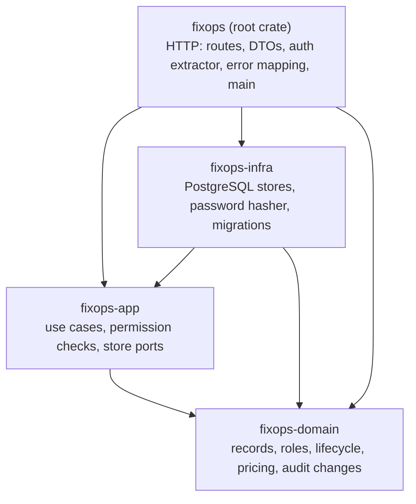
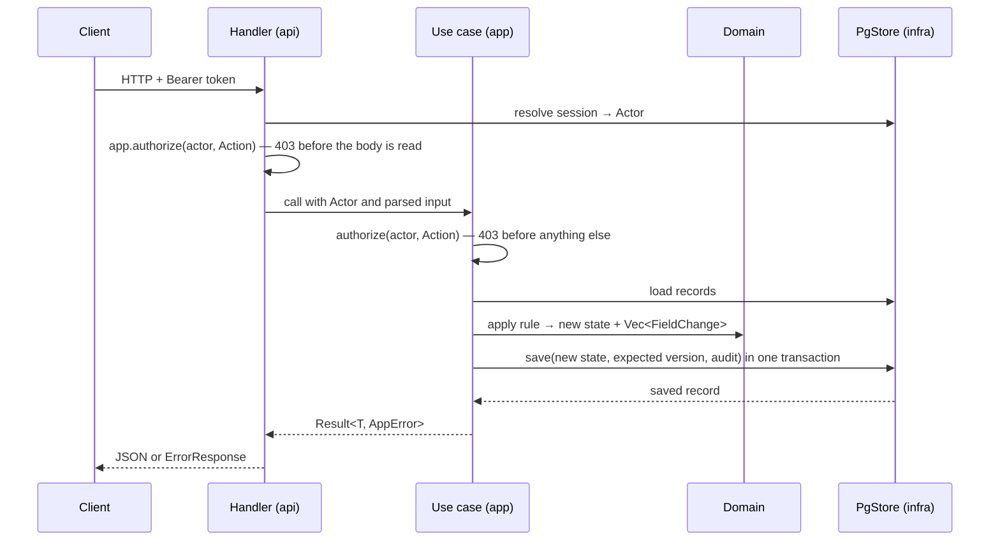

# Architecture

What the system must do is in [`spec/srs.md`](../spec/srs.md) and [`spec/openapi.yaml`](../spec/openapi.yaml). This document covers how the service is built. Tools and versions are in [stack](stack.md).

## Layers

One Cargo workspace with one crate per layer. Each layer depends only on the layers below it, and the compiler enforces this.



| Crate | Owns | Must not |
|---|---|---|
| `fixops-domain` (`crates/domain`) | Typed ids, `Role`, `Action`, value types (`Cents`, names, phones), `RepairOrder` state machine, pricing, `FieldChange` | Do I/O, use async, depend on serde, sqlx or axum |
| `fixops-app` (`crates/app`) | One module per area (`staff`, `clients`, `orders`, …). Each has a store trait (port) and `impl<S: XStore> App<S>` with its use cases. `AppError`. | Know about HTTP status codes or SQL |
| `fixops-infra` (`crates/infra`) | `PgStore` implementing every port, SQL, migrations, argon2 | Contain business rules |
| `fixops` (root, `src/`) | axum router, request/response DTOs (serde), `Actor` extractor, `ApiError` → `ErrorResponse` | Contain business rules or SQL |

## Request flow



1. **Authenticate.** The `Actor` extractor reads `Authorization: Bearer <token>`, hashes it, and looks up an unexpired session of an enabled account. Missing or unknown token → `401 UNAUTHENTICATED`. Every protected handler takes `Actor`, so there is no unauthenticated path to records (REQ-F-001).
2. **Authorize.** A handler that takes path parameters or a body extracts them as `Result<PathId, ApiError>` and `Result<Json<T>, ApiError>`, calls `state.app.authorize(actor, Action::…)?` first, and only then unwraps them and builds domain values. The order of answers is therefore always `401` → `403` → `400` → `404`/`409`, so a denied role never learns the validation rules (ADD-002 §2). As defense in depth, the first line of every use case is `crate::authorize(actor, Action::…)?`, which wraps `Actor::require` and records the action in the log. The role matrix is one function in `fixops-domain` (`Role::can`) and mirrors `x-roles` in the contract. Administrator gets every Receptionist and Technician action through that matrix, not through a bypass, so guards still apply (ADD-001).
3. **Validate.** DTOs only handle JSON shape: types, enums, unknown fields (`#[serde(deny_unknown_fields)]`), and `null` in optional fields the contract does not mark `nullable` (`#[serde(default, deserialize_with = "json::not_null")]`). Business values are built through domain constructors (`ClientName::parse`, `Cents::new`, …) that return a domain error naming the field. The app layer maps it to `400 VALIDATION_ERROR`.
4. **Apply the rule.** Domain methods take the current record and return the new one plus the list of `FieldChange`s, or a domain error. They never half-apply.
5. **Persist with audit.** The store writes the record and its audit entries in one transaction. A rejected action never reaches the store, so it changes nothing.

## Audit contract

Every successful change writes one `audit_log` row per changed field (REQ-NF-003, REQ-F-018):

| Column | Meaning |
|---|---|
| `actor_id` | Staff account that made the change |
| `recorded_at` | `now()` of the writing transaction |
| `record_type` | `StaffAccount`, `Client`, `Device`, `RepairOrder` |
| `record_id` | Id of the changed record |
| `field` | Contract field name, e.g. `completed_labor_cents` |
| `previous_value`, `new_value` | Text rendering; `NULL` when absent. Creation logs each set field with `previous_value = NULL` |

Rules:

- Store write methods take the audit changes as an argument and insert them in the same transaction. There is no way to write a record without passing its changes.
- Passwords are never logged: a password change is audited as `field = "password"` with both values `NULL`.
- Audit rows are append-only. No code updates or deletes them, and database triggers refuse `UPDATE`, `DELETE` and `TRUNCATE` on `audit_log`.

## Logging

Separate from the audit log. The audit log is the business record of data changes. The operational log records everything the service does, so each test run or manual run can be analysed afterwards. Implemented in `src/telemetry.rs` and `src/http/trace.rs`.

| Line | Level | Written by | Fields |
|---|---|---|---|
| `request finished` | `INFO`, `WARN` for 4xx, `ERROR` for 5xx | HTTP layer, once per request | `status`, `latency_ms` |
| `request rejected` | `WARN` (`ERROR` `request failed` for internal errors) | `ApiError` rendering | `code`, `reason`, `details` |
| `action denied` | `WARN` | `fixops_app::authorize` | `actor_id`, `role`, `action` |
| `record changed` | `INFO` | `insert_audit` in infra | `actor_id`, `record_type`, `record_id`, `fields` (names only) |

Every line inside a request carries the `request` span: `request_id` (from `x-request-id`, generated when missing and echoed back), `method`, `path`, plus `actor_id`, `role` and `action` once they are known.

- Output goes to the console and to a daily JSON-lines file, `$FIXOPS_LOG_DIR/fixops.log.YYYY-MM-DD` (default `var/log`). `RUST_LOG` sets the filter.
- Never logged: passwords, password hashes, tokens, headers, query strings, and changed values (those stay in the audit log). `tests/logging.rs` enforces this.
- New use cases need no extra logging code: `authorize` records the action, and `insert_audit` logs the change.

## Data and money

- Ids are `bigint generated always as identity`, wrapped in typed ids (`ClientId`, `OrderId`, …).
- Money is `Cents(i64)`, never negative, stored as `bigint`, serialized as `*_cents` integers. No floats anywhere.
- Timestamps are `time::OffsetDateTime`, stored as `timestamptz`, serialized as RFC 3339.
- Enums are stored as `text` with a `CHECK` constraint listing the allowed values.
- Uniqueness (ticket number, username) is a database `UNIQUE` constraint. The store maps the violation to `StoreError::Duplicate`, and the use case turns it into `409 CONFLICT`.
- Searches (`q` on clients and devices) are case-insensitive substring matches: `ILIKE` with `%`, `_` and `\` escaped, served by `pg_trgm` GIN indexes. Exact filters (`client_id`, `status`, `ticket_number`) use B-tree indexes.

### Intake

Creating an order checks, in this order: the ticket number and ids are valid (`400`); the client, device and assignee exist (`404`, `details.field` names the link); then `NewRepairOrder::intake` requires the device to belong to the client and the assignee to have the `Technician` role (`409 CONFLICT`, `details.field`); finally a taken ticket number is `409 CONFLICT` with `details.ticket_number`. An Administrator can perform Technician actions but is not a Technician, so it cannot be the assignee. A composite foreign key `(device_id, client_id) → devices (id, client_id)` keeps the device-client link true in the database as well.

### Settlement

`labor_discount_cents` and `settlement_cents` are derived, never entered:

- While an order is open, they are computed from incurred charges and the client's **current** tier, so a tier change before final settlement applies (BDD-015).
- When the order reaches `Completed` or `Cancelled`, the computed values are stored on the order and stay fixed after that.
- Discount = labor × rate, rounded half-up to whole cents in integer arithmetic.
- One domain function, `pricing::current_settlement`, gives both values; the use case returns it with the order (`OrderView`), so the HTTP layer never computes money. It returns the stored values of a terminal order and `0` for a `Received` order. The other open states and the tier discount arrive with the transitions that reach them.

### Concurrency

Clients, devices and orders carry a `version` column. Each update is `UPDATE … WHERE id = $1 AND version = $2`, increments the version, and zero updated rows returns `StoreError::Stale`. Two staff saving the same record at once cannot silently overwrite each other. A stale write commits neither the record nor its audit rows.

## Sessions

- `POST /api/v1/sessions` checks the password with argon2 and issues 32 random bytes, base64url-encoded. Only the SHA-256 hash is stored, with a 12-hour expiry.
- An unknown username and a wrong password get the same `401` after the same argon2 work: without an account the hasher checks a dummy hash with the same parameters, so the response time does not reveal the username either. A disabled account gets `403` only after its password matched, so neither answer reveals which accounts exist.
- Password hashing is a port (`PasswordHasher`) like the stores, and `PgStore` implements it with argon2 on the blocking thread pool. The HTTP layer still holds one `App<PgStore>`.
- Disabling an account deletes its sessions in the same transaction, so access ends at once (REQ-F-019). A role change applies from the next request, because every request reads the account's current role.
- The first Administrator is created at startup from `FIXOPS_BOOTSTRAP_ADMIN_USERNAME` and `FIXOPS_BOOTSTRAP_ADMIN_PASSWORD`, only when no staff account exists. Its creation is audited with itself as the actor.

## Errors

| `ErrorKind` (app) | HTTP | `code` |
|---|---|---|
| `Validation` | 400 | `VALIDATION_ERROR` |
| `Unauthenticated` | 401 | `UNAUTHENTICATED` |
| `Forbidden` | 403 | `FORBIDDEN` |
| `NotFound` | 404 | `NOT_FOUND` |
| `Conflict` | 409 | `CONFLICT` |
| `Guard` | 409 | `GUARD_VIOLATION` |
| `Internal` | 500 | `INTERNAL` (logged; no details leaked) |

Malformed JSON and unknown fields go through the `Json` extractor in `src/http/json.rs` and also return `400 VALIDATION_ERROR`.

## Source layout

```text
crates/domain/src/   error.rs, id.rs, staff.rs, audit.rs, money.rs, client.rs, device.rs, order.rs, pricing.rs
crates/app/src/      error.rs, staff.rs, clients.rs, devices.rs, orders.rs, audit.rs
crates/infra/src/    lib.rs (PgStore), error.rs, staff.rs, clients.rs, …
crates/infra/migrations/   <timestamp>_<name>.sql
src/http/            mod.rs (router), error.rs, json.rs, params.rs, auth.rs, sessions.rs, staff.rs, audit.rs, clients.rs, …
tests/               one HTTP test file per area (staff_access.rs, intake.rs, …), common/ harness
```

Each area keeps the same file name in every layer, so one package of work touches its own files and parallel work rarely conflicts.

## Testing

Work is test-first. Tests come from the SRS acceptance criteria and BDD scenarios, never from what the code happens to return.

| Level | Where | Covers |
|---|---|---|
| Domain unit | `#[cfg(test)]` in `crates/domain` | Lifecycle table, guards, pricing and rounding boundaries, value validation |
| Use case unit | `#[cfg(test)]` in `crates/app` (optional, with fakes) | Permission checks and orchestration that HTTP tests can't isolate |
| HTTP | `tests/*.rs` with `#[sqlx::test(migrator = "fixops_infra::MIGRATOR")]` | Every BDD scenario and every role's allowed and denied action, through the real router and a fresh database |
| Contract | `tests/contract.rs`, `tests/prism` | The OpenAPI document itself |

HTTP tests name their scenario (`bdd_005_cancel_before_diagnosis_charges_nothing`). A denied action is tested by reading the record back and checking that it, and the audit log, did not change.

## Operations

- **Run locally:** `docker compose up -d --wait`, then `cargo run`. Migrations run at startup.
- **Configuration:** environment variables, listed in the README.
- **Backups (REQ-NF-004):** a daily `pg_dump` with a timed restore exercise. Added in P7.
