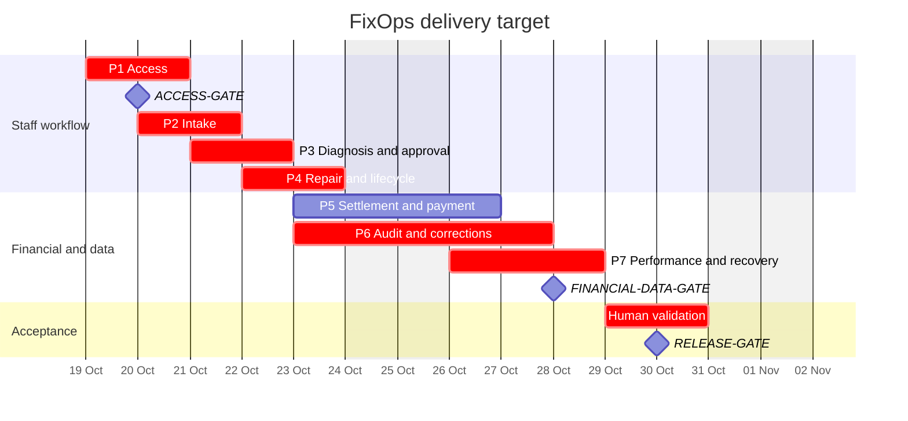

# Delivery plan

**Tracker:** [FixOps project](https://linear.app/fixops/project/fixops-965d39cb6a8a) (Linear, team FIX) · **Scope:** [SRS 1.0.3](../spec/srs.md) — 24 requirements, 21 BDD scenarios · **Status:** P1–P7 verified; all gates GO.

The service uses axum, Tokio and PostgreSQL. Platform choices are in [stack](stack.md) and [architecture](architecture.md). All packages are implemented and verified; the order of work followed the dependencies below. The original schedule is retained as the planning baseline, not a current forecast.

## Work packages

Each package has a Test, a Feature, and a Verification ticket.

| Package | Requirements | Test | Feature | Verification |
|---|---|---|---|---|
| P1 — Staff access and accounts | REQ-F-001, 002, 019; REQ-NF-002, 003 | [FIX-27](https://linear.app/fixops/issue/FIX-27) | [FIX-28](https://linear.app/fixops/issue/FIX-28) | [FIX-29](https://linear.app/fixops/issue/FIX-29) |
| P2 — Client, device and order intake | REQ-F-003, 004, 005, 017 | [FIX-30](https://linear.app/fixops/issue/FIX-30) | [FIX-31](https://linear.app/fixops/issue/FIX-31) | [FIX-32](https://linear.app/fixops/issue/FIX-32) |
| P3 — Diagnosis, estimate and approval | REQ-F-006, 007, 008, 009 | [FIX-33](https://linear.app/fixops/issue/FIX-33) | [FIX-34](https://linear.app/fixops/issue/FIX-34) | [FIX-35](https://linear.app/fixops/issue/FIX-35) |
| P4 — Repair and order lifecycle | REQ-F-010, 011, 014 | [FIX-36](https://linear.app/fixops/issue/FIX-36) | [FIX-37](https://linear.app/fixops/issue/FIX-37) | [FIX-38](https://linear.app/fixops/issue/FIX-38) |
| P5 — Settlement, cancellation, payment, pickup | REQ-F-012, 013, 015, 016 | [FIX-39](https://linear.app/fixops/issue/FIX-39) | [FIX-40](https://linear.app/fixops/issue/FIX-40) | [FIX-41](https://linear.app/fixops/issue/FIX-41) |
| P6 — Audit and administrator corrections | REQ-F-018; REQ-NF-003 | [FIX-42](https://linear.app/fixops/issue/FIX-42) | [FIX-43](https://linear.app/fixops/issue/FIX-43) | [FIX-44](https://linear.app/fixops/issue/FIX-44) |
| P7 — Performance and backup recovery | REQ-NF-001, 004 | [FIX-45](https://linear.app/fixops/issue/FIX-45) | [FIX-46](https://linear.app/fixops/issue/FIX-46) | [FIX-47](https://linear.app/fixops/issue/FIX-47) |

Control tickets:

| Ticket | Purpose | Status |
|---|---|---|
| [FIX-23](https://linear.app/fixops/issue/FIX-23) | Specification review | Done |
| [FIX-24](https://linear.app/fixops/issue/FIX-24) | Permission addendum ([ADD-001](../spec/addenda/ADD-001-permissions.md)) | Done |
| [FIX-25](https://linear.app/fixops/issue/FIX-25) | Planning documents | Done |
| [FIX-26](https://linear.app/fixops/issue/FIX-26) | PLAN-GATE | GO |
| [FIX-48](https://linear.app/fixops/issue/FIX-48) | ACCESS-GATE: staff access verified | GO |
| [FIX-49](https://linear.app/fixops/issue/FIX-49) | FINANCIAL-DATA-GATE: pricing, lifecycle, audit, performance, recovery verified | GO |
| [FIX-50](https://linear.app/fixops/issue/FIX-50) | Human validation of the staff workflow | Done |
| [FIX-51](https://linear.app/fixops/issue/FIX-51) | RELEASE-GATE | GO |

P1 defines the shared audit contract (atomic write + audit entry). P2–P5 tests check audit fields for each change as it is built; P6 completes coverage and adds corrections. A change without an audit entry is never accepted on the grounds that P6 comes later.

## Schedule

Target: 19–30 October 2026, weekdays. Dates are forecasts. A missed review or failed check moves dependent work; it never skips a gate.

- **Technical effort:** 63 agent-hours, at most two parallel lanes with separate files.
- **Human effort:** about 8 hours of review, max 60 minutes per weekday. Reviews, validation and gate decisions all share this limit.
- **Backups** run every day, including weekends.

| Issue | Type | Start | Due | Agent h | Human min |
|---|---|---|---|---|---|
| FIX-27 | P1 Test | 10-19 | 10-20 | 2 | 20 |
| FIX-28 | P1 Feature | 10-20 | 10-20 | 4 | — |
| FIX-29 | P1 Verification | 10-20 | 10-20 | 1 | 20 |
| FIX-48 | ACCESS-GATE | 10-20 | 10-20 | — | 10 |
| FIX-30 | P2 Test | 10-20 | 10-21 | 2 | 20 |
| FIX-31 | P2 Feature | 10-21 | 10-21 | 4 | — |
| FIX-32 | P2 Verification | 10-21 | 10-21 | 1 | 20 |
| FIX-33 | P3 Test | 10-21 | 10-21 | 2 | 20 |
| FIX-34 | P3 Feature | 10-22 | 10-22 | 4 | — |
| FIX-35 | P3 Verification | 10-22 | 10-22 | 1 | 20 |
| FIX-36 | P4 Test | 10-22 | 10-22 | 2 | 20 |
| FIX-37 | P4 Feature | 10-23 | 10-23 | 4 | — |
| FIX-38 | P4 Verification | 10-23 | 10-23 | 1 | 20 |
| FIX-39 | P5 Test | 10-23 | 10-23 | 2 | 20 |
| FIX-42 | P6 Test | 10-23 | 10-23 | 2 | 20 |
| FIX-40 | P5 Feature | 10-26 | 10-26 | 4 | — |
| FIX-41 | P5 Verification | 10-26 | 10-26 | 1 | 20 |
| FIX-43 | P6 Feature | 10-26 | 10-27 | 8 | — |
| FIX-45 | P7 Test | 10-26 | 10-27 | 2 | 20 |
| FIX-44 | P6 Verification | 10-27 | 10-27 | 2 | 30 |
| FIX-46 | P7 Feature | 10-27 | 10-28 | 6 | — |
| FIX-47 | P7 Verification | 10-28 | 10-28 | 3 | 30 |
| FIX-49 | FINANCIAL-DATA-GATE | 10-28 | 10-28 | — | 15 |
| FIX-50 | Validation | 10-29 | 10-30 | — | 90 |
| FIX-51 | RELEASE-GATE | 10-30 | 10-30 | — | 15 |

Planning tickets FIX-23–26 (5 agent-hours, 60 human minutes) are complete. Ticket dependencies are in the [workflow](workflow.md#dependencies).

**Critical path:** P1 → ACCESS → P2 → P3 → P4 → P6 → P7 (including a full 24-hour backup observation, started on 27 Oct) → FINANCIAL-DATA → validation → RELEASE. If P5 slips past 26 Oct it also becomes critical.

## Gates

- **ACCESS-GATE:** checks that sign-in and role restrictions work, and that a denied action changes nothing (REQ-F-001, 002, 019; REQ-NF-002). Blocks P2–P7.
- **FINANCIAL-DATA-GATE:** checks lifecycle and payment guards, cancellation charges, rounding, current tier, audit, corrections, performance, and an actual restore (REQ-F-010–016, 018; REQ-NF-001, 003, 004). Blocks validation.
- **RELEASE-GATE:** requires every package Verification plus human validation.

Gates record decisions only; they produce no code.
