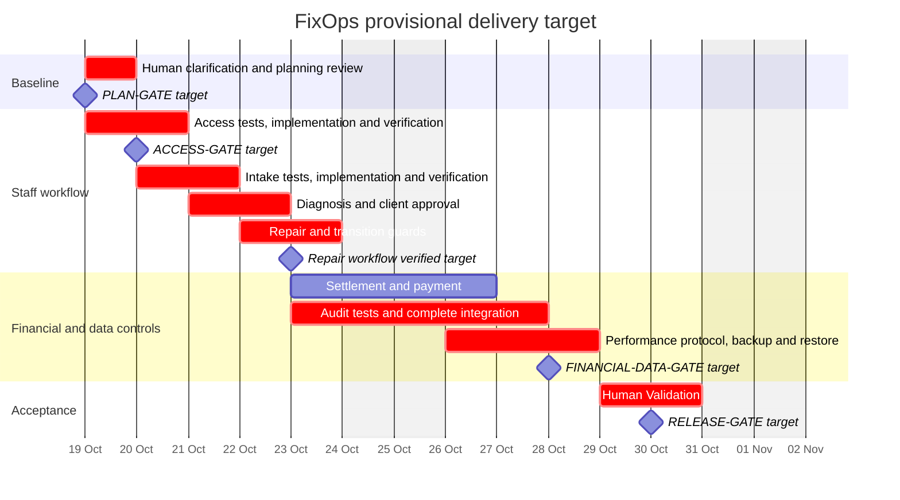
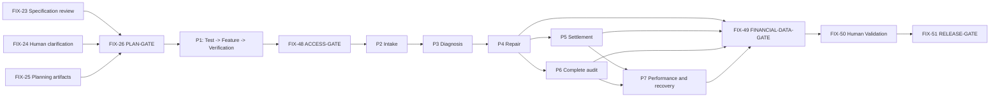

# FixOps delivery plan

## Baseline and delivery boundary

**Tracker:** [FixOps](https://linear.app/fixops/project/fixops-965d39cb6a8a) in Linear Personal, team FIX. **Owner:** Dmytro Shadura. **Status:** planning package accepted by Dmytro Shadura; PLAN-GATE is GO. Product implementation and later Gates remain future work.

The source of product scope is SRS 1.0.1: the original approved SRS 1.0.0 / SPEC-GATE-01 at `31bf3317552f62adbafbebd32fa772b38c9c6a8e`, amended by human-approved [ADD-001](../spec/addenda/ADD-001-permissions.md). The active specification has 23 requirements, 23 acceptance criteria and 20 BDD scenarios. The current dependency-free Rust program is a partial prototype. Its three passing integration tests do not demonstrate the target web system, persistence, permissions, audit, money boundaries, recovery, or performance.

This delivery-planning change creates the tracker and versioned management artifacts. It does not implement the product, change production APIs, select new dependencies, or claim that future acceptance evidence exists. The product remains staff-only and browser-based; no customer portal, notifications, inventory, payment-provider integration, analytics, bulk discounts or automatic loyalty progression is added.

The human approved preparation of this planning package, English artifacts, a project inside the existing FixOps team, a provisional two-week target, one hour of human review per weekday, and editorial removal of educational wording. The initial preparation authorization was followed by explicit approval of the prepared package and authorization to record PLAN-GATE GO on 2026-10-15. This permits the next planned work, while each Test and later Gate remains a prerequisite. See [decision record](../logs/plan_gate.md), [workflow](workflow.md), [risk register](risk_register.md), and [traceability](../spec/traceability.md).

## Work packages and traceability

Each package has separate Test, Feature and Verification tickets. All 29 issues are assigned to Dmytro for accountability; descriptions identify the technical agent performer and human acceptance role. The SRS leaves framework/storage/API choices open: the earliest platform design review must establish the minimum coherent web, identity, persistence and audit approach and re-estimate before dependent work. No architecture is assumed to exist in the prototype.

| Package | Requirements | Test / Feature / Verification |
|---|---|---|
| P1 - Staff access and accounts | REQ-F-001, REQ-F-002, REQ-F-019, REQ-NF-002, REQ-NF-003 | [FIX-27](https://linear.app/fixops/issue/FIX-27/test-staff-access) / [FIX-28](https://linear.app/fixops/issue/FIX-28/implement-staff-access) / [FIX-29](https://linear.app/fixops/issue/FIX-29/verify-staff-access) |
| P2 - Client, device and order intake | REQ-F-003, REQ-F-004, REQ-F-005, REQ-F-017 | [FIX-30](https://linear.app/fixops/issue/FIX-30/test-client-and-repair-intake) / [FIX-31](https://linear.app/fixops/issue/FIX-31/implement-client-and-repair-intake) / [FIX-32](https://linear.app/fixops/issue/FIX-32/verify-client-and-repair-intake) |
| P3 - Diagnosis, estimates and client approval | REQ-F-006, REQ-F-007, REQ-F-008, REQ-F-009 | [FIX-33](https://linear.app/fixops/issue/FIX-33/test-diagnosis-and-approval) / [FIX-34](https://linear.app/fixops/issue/FIX-34/implement-diagnosis-and-approval) / [FIX-35](https://linear.app/fixops/issue/FIX-35/verify-diagnosis-and-approval) |
| P4 - Repair evidence and guarded order lifecycle | REQ-F-010, REQ-F-011, REQ-F-014 | [FIX-36](https://linear.app/fixops/issue/FIX-36/test-repair-workflow) / [FIX-37](https://linear.app/fixops/issue/FIX-37/implement-repair-workflow) / [FIX-38](https://linear.app/fixops/issue/FIX-38/verify-repair-workflow) |
| P5 - Settlement, cancellation, payment and pickup | REQ-F-012, REQ-F-013, REQ-F-015, REQ-F-016 | [FIX-39](https://linear.app/fixops/issue/FIX-39/test-pricing-and-payments) / [FIX-40](https://linear.app/fixops/issue/FIX-40/implement-pricing-and-payments) / [FIX-41](https://linear.app/fixops/issue/FIX-41/verify-pricing-and-payments) |
| P6 - Persistent audit and administrator corrections | REQ-F-018, REQ-NF-003 | [FIX-42](https://linear.app/fixops/issue/FIX-42/test-audit-and-order-corrections) / [FIX-43](https://linear.app/fixops/issue/FIX-43/implement-audit-and-order-corrections) / [FIX-44](https://linear.app/fixops/issue/FIX-44/verify-audit-and-order-corrections) |
| P7 - Visible-result performance and backup recovery | REQ-NF-001, REQ-NF-004 | [FIX-45](https://linear.app/fixops/issue/FIX-45/test-performance-and-recovery) / [FIX-46](https://linear.app/fixops/issue/FIX-46/implement-performance-and-recovery) / [FIX-47](https://linear.app/fixops/issue/FIX-47/verify-performance-and-recovery) |

P1 owns the initial shared audit-event and atomic write/audit contract. P2-P5 mutation tests verify actor, time, record, field and old/new values immediately; P6 completes coverage and authorized corrections. An unlogged mutation is not acceptable merely because an audit package is scheduled later.

The human resolved [FIX-24](https://linear.app/fixops/issue/FIX-24/confirm-staff-permissions) on 2026-10-15 through [ADD-001](../spec/addenda/ADD-001-permissions.md): Receptionist and Administrator may cancel from the permitted source states; Administrator inherits every existing staff action and may correct any RepairOrder field, including on terminal records, while business constraints and audit remain mandatory. The clarification prerequisite is satisfied; Test acceptance and PLAN/ACCESS Gate prerequisites still apply. SRS exact payment equality governs completion; the glossary is not permission to accept overpayment as equality.

## Calendar and capacity

**Target:** 19-30 October 2026, weekdays, Europe/Kyiv. PLAN-GATE is GO; the target dates remain provisional engineering forecasts, subject to the platform review and actual delivery evidence. The clarification was approved before the target window; its original 20-minute allocation is retained as capacity for rechecking the approved wording during preflight review. An unfinished prerequisite or missed human review moves dependent work; it never authorizes bypassing a gate. Backups run every day, including weekends; development weekdays do not relax the 24-hour backup requirement.

Technical estimates below total **63 agent-hours**, including 5 hours of planning/specification work. These are optimistic planning budgets, not measured rates or evidence that a full web stack can be built that quickly. Use at most two technical lanes (maximum 16 aggregate engineering hours per weekday) with disjoint file ownership; reserve one lane for the main dependency chain. Reforecast after the platform review.

Human effort totals **490 minutes (8 hours 10 minutes)** across 10 hours of available capacity. Test-oracle review, verification acceptance, risk inspection and gate decisions share the same daily limit; they are not extra allowances. Feature human review is charged to its linked Verification, not counted twice. Validation is performed by the human.

| Date | Planned result / human activity | Human minutes | Remaining daily capacity |
|---|---|---|---|
| 2026-10-19 | Baseline/clarification/document review (20 + 20 + 10); PLAN decision (10); prepare P1 tests after GO | 60 | 0 min |
| 2026-10-20 | P1 test review (20), access verification (20), ACCESS decision (10); prepare P2 tests after GO | 50 | 10 min |
| 2026-10-21 | P2 test review (20), intake verification (20), P3 test review (20) | 60 | 0 min |
| 2026-10-22 | Diagnosis verification (20), P4 test review (20) | 40 | 20 min |
| 2026-10-23 | Repair verification (20), P5 test review (20), P6 test review (20) | 60 | 0 min |
| 2026-10-26 | Settlement verification (20); audit integration in the second technical lane; prepare P7 protocol | 20 | 40 min |
| 2026-10-27 | Audit verification (30), P7 protocol review (20); start backup observation after integration is ready | 50 | 10 min |
| 2026-10-28 | Performance/restore verification (30), FINANCIAL-DATA decision (15) | 45 | 15 min |
| 2026-10-29 | Human workflow Validation, first session (60) | 60 | 0 min |
| 2026-10-30 | Human Validation, final session (30), RELEASE decision (15) | 45 | 15 min |

The second lane prepares independent protocols and audit integration; it does not start Features before their native blockers are accepted. On 27 October, finish P6 integration early enough to begin the full 24-hour backup observation that afternoon. A later start, insufficient daily backups, or a failed restore moves the 28 October safety decision and subsequent acceptance. The recovery criterion is queryable restored records within 24 hours of recovery start, measured separately from the backup observation.

Bars aggregate package Test/Feature/Verification windows; the linked issue table and native blocking relations below determine execution order within a date. Milestone dates are review targets, not completed decisions.

| Linear milestone | Target |
|---|---|
| Baseline and planning decision | 2026-10-19 |
| Staff access approved | 2026-10-20 |
| Repair workflow verified | 2026-10-23 |
| Financial and data safety approved | 2026-10-28 |
| Human acceptance and release decision | 2026-10-30 |

## Dependencies, gates and critical path

Use native Linear blocked-by relationships. The [workflow](workflow.md) provides the exact predecessor table for all tickets. Every Feature requires its own accepted Test and PLAN GO; P2-P7 also require ACCESS GO. Tests mean reviewed runnable checks or a repeatable protocol with honest baseline outcomes; feature-specific expected-red tests can be accepted before the Feature exists. No future tests have been written by this planning change.

This diagram summarizes package dependencies; the early P1 audit contract and per-ticket test blockers are defined in the issue table. All Verification tickets additionally block Validation and RELEASE.

**Manually determined calendar-critical chain:** baseline/approved-addendum review and PLAN -> P1 Test/Feature/Verification -> ACCESS -> P2 Feature -> P3 Feature -> P4 Feature -> P6 Feature/Verification -> P7 Feature/Verification (including the full backup observation) -> FINANCIAL-DATA -> human Validation -> RELEASE. The chain uses the fixed daily review slots and the recovery observation rather than pretending raw generation time alone determines completion. A missed review on this chain, failure needing rework, or delayed backup observation shifts a downstream review beyond its planned slot. P5 joins P7 through its native Feature blocker and P6 verification through settlement Verification; if it misses 26 October it becomes co-critical. Test dependencies before each Feature remain mandatory even where the summary chain abbreviates them.

**High-consequence controls:** ACCESS reviews unauthorized disclosure and denied-write immutability (REQ-F-001/002/019, REQ-NF-002); FINANCIAL-DATA reviews lifecycle and full-payment guards, cancellation/rounding/current tier, complete audit and corrections, performance evidence and actual restoration (REQ-F-010-016/018, REQ-NF-001/003/004). RELEASE requires every package Verification plus explicit human Validation. Gates produce decisions, not code.

## Issue schedule and estimates

All windows and due dates below match the Linear issue descriptions. Technical effort is work time; human effort is the review allocation above, and waiting for a human slot is calendar time. Durations are not story points.

| Issue | Type / package | Start | Due | Agent hours | Human min | Native blocking predecessors |
|---|---|---|---|---|---|---|
| [FIX-23](https://linear.app/fixops/issue/FIX-23/review-requirements) | Specification / SPEC | 2026-10-19 | 2026-10-19 | 1 | 20 | None |
| [FIX-24](https://linear.app/fixops/issue/FIX-24/confirm-staff-permissions) | Addendum / ADD | 2026-10-19 | 2026-10-19 | 1 | 20 | None |
| [FIX-25](https://linear.app/fixops/issue/FIX-25/publish-the-delivery-plan) | Documentation / DOC | 2026-10-19 | 2026-10-19 | 3 | 10 | None |
| [FIX-26](https://linear.app/fixops/issue/FIX-26/plan-gate-approve-the-plan) | Gate / PLAN | 2026-10-19 | 2026-10-19 | 0 | 10 | [FIX-23](https://linear.app/fixops/issue/FIX-23/review-requirements), [FIX-24](https://linear.app/fixops/issue/FIX-24/confirm-staff-permissions), [FIX-25](https://linear.app/fixops/issue/FIX-25/publish-the-delivery-plan) |
| [FIX-27](https://linear.app/fixops/issue/FIX-27/test-staff-access) | Test / P1-T | 2026-10-19 | 2026-10-20 | 2 | 20 | [FIX-23](https://linear.app/fixops/issue/FIX-23/review-requirements), [FIX-26](https://linear.app/fixops/issue/FIX-26/plan-gate-approve-the-plan), [FIX-24](https://linear.app/fixops/issue/FIX-24/confirm-staff-permissions) |
| [FIX-28](https://linear.app/fixops/issue/FIX-28/implement-staff-access) | Feature / P1-F | 2026-10-20 | 2026-10-20 | 4 | 0 | [FIX-26](https://linear.app/fixops/issue/FIX-26/plan-gate-approve-the-plan), [FIX-27](https://linear.app/fixops/issue/FIX-27/test-staff-access) |
| [FIX-29](https://linear.app/fixops/issue/FIX-29/verify-staff-access) | Verification / P1-V | 2026-10-20 | 2026-10-20 | 1 | 20 | [FIX-28](https://linear.app/fixops/issue/FIX-28/implement-staff-access) |
| [FIX-30](https://linear.app/fixops/issue/FIX-30/test-client-and-repair-intake) | Test / P2-T | 2026-10-20 | 2026-10-21 | 2 | 20 | [FIX-23](https://linear.app/fixops/issue/FIX-23/review-requirements), [FIX-48](https://linear.app/fixops/issue/FIX-48/access-gate-check-staff-access), [FIX-27](https://linear.app/fixops/issue/FIX-27/test-staff-access) |
| [FIX-31](https://linear.app/fixops/issue/FIX-31/implement-client-and-repair-intake) | Feature / P2-F | 2026-10-21 | 2026-10-21 | 4 | 0 | [FIX-26](https://linear.app/fixops/issue/FIX-26/plan-gate-approve-the-plan), [FIX-30](https://linear.app/fixops/issue/FIX-30/test-client-and-repair-intake), [FIX-48](https://linear.app/fixops/issue/FIX-48/access-gate-check-staff-access) |
| [FIX-32](https://linear.app/fixops/issue/FIX-32/verify-client-and-repair-intake) | Verification / P2-V | 2026-10-21 | 2026-10-21 | 1 | 20 | [FIX-31](https://linear.app/fixops/issue/FIX-31/implement-client-and-repair-intake) |
| [FIX-33](https://linear.app/fixops/issue/FIX-33/test-diagnosis-and-approval) | Test / P3-T | 2026-10-21 | 2026-10-21 | 2 | 20 | [FIX-23](https://linear.app/fixops/issue/FIX-23/review-requirements), [FIX-48](https://linear.app/fixops/issue/FIX-48/access-gate-check-staff-access), [FIX-30](https://linear.app/fixops/issue/FIX-30/test-client-and-repair-intake) |
| [FIX-34](https://linear.app/fixops/issue/FIX-34/implement-diagnosis-and-approval) | Feature / P3-F | 2026-10-22 | 2026-10-22 | 4 | 0 | [FIX-26](https://linear.app/fixops/issue/FIX-26/plan-gate-approve-the-plan), [FIX-33](https://linear.app/fixops/issue/FIX-33/test-diagnosis-and-approval), [FIX-31](https://linear.app/fixops/issue/FIX-31/implement-client-and-repair-intake), [FIX-48](https://linear.app/fixops/issue/FIX-48/access-gate-check-staff-access) |
| [FIX-35](https://linear.app/fixops/issue/FIX-35/verify-diagnosis-and-approval) | Verification / P3-V | 2026-10-22 | 2026-10-22 | 1 | 20 | [FIX-34](https://linear.app/fixops/issue/FIX-34/implement-diagnosis-and-approval) |
| [FIX-36](https://linear.app/fixops/issue/FIX-36/test-repair-workflow) | Test / P4-T | 2026-10-22 | 2026-10-22 | 2 | 20 | [FIX-23](https://linear.app/fixops/issue/FIX-23/review-requirements), [FIX-24](https://linear.app/fixops/issue/FIX-24/confirm-staff-permissions), [FIX-48](https://linear.app/fixops/issue/FIX-48/access-gate-check-staff-access), [FIX-33](https://linear.app/fixops/issue/FIX-33/test-diagnosis-and-approval) |
| [FIX-37](https://linear.app/fixops/issue/FIX-37/implement-repair-workflow) | Feature / P4-F | 2026-10-23 | 2026-10-23 | 4 | 0 | [FIX-26](https://linear.app/fixops/issue/FIX-26/plan-gate-approve-the-plan), [FIX-36](https://linear.app/fixops/issue/FIX-36/test-repair-workflow), [FIX-34](https://linear.app/fixops/issue/FIX-34/implement-diagnosis-and-approval), [FIX-48](https://linear.app/fixops/issue/FIX-48/access-gate-check-staff-access), [FIX-24](https://linear.app/fixops/issue/FIX-24/confirm-staff-permissions) |
| [FIX-38](https://linear.app/fixops/issue/FIX-38/verify-repair-workflow) | Verification / P4-V | 2026-10-23 | 2026-10-23 | 1 | 20 | [FIX-37](https://linear.app/fixops/issue/FIX-37/implement-repair-workflow) |
| [FIX-39](https://linear.app/fixops/issue/FIX-39/test-pricing-and-payments) | Test / P5-T | 2026-10-23 | 2026-10-23 | 2 | 20 | [FIX-23](https://linear.app/fixops/issue/FIX-23/review-requirements), [FIX-24](https://linear.app/fixops/issue/FIX-24/confirm-staff-permissions), [FIX-48](https://linear.app/fixops/issue/FIX-48/access-gate-check-staff-access), [FIX-36](https://linear.app/fixops/issue/FIX-36/test-repair-workflow) |
| [FIX-40](https://linear.app/fixops/issue/FIX-40/implement-pricing-and-payments) | Feature / P5-F | 2026-10-26 | 2026-10-26 | 4 | 0 | [FIX-26](https://linear.app/fixops/issue/FIX-26/plan-gate-approve-the-plan), [FIX-39](https://linear.app/fixops/issue/FIX-39/test-pricing-and-payments), [FIX-37](https://linear.app/fixops/issue/FIX-37/implement-repair-workflow), [FIX-31](https://linear.app/fixops/issue/FIX-31/implement-client-and-repair-intake), [FIX-48](https://linear.app/fixops/issue/FIX-48/access-gate-check-staff-access), [FIX-24](https://linear.app/fixops/issue/FIX-24/confirm-staff-permissions) |
| [FIX-41](https://linear.app/fixops/issue/FIX-41/verify-pricing-and-payments) | Verification / P5-V | 2026-10-26 | 2026-10-26 | 1 | 20 | [FIX-40](https://linear.app/fixops/issue/FIX-40/implement-pricing-and-payments) |
| [FIX-42](https://linear.app/fixops/issue/FIX-42/test-audit-and-order-corrections) | Test / P6-T | 2026-10-23 | 2026-10-23 | 2 | 20 | [FIX-23](https://linear.app/fixops/issue/FIX-23/review-requirements), [FIX-24](https://linear.app/fixops/issue/FIX-24/confirm-staff-permissions), [FIX-48](https://linear.app/fixops/issue/FIX-48/access-gate-check-staff-access), [FIX-27](https://linear.app/fixops/issue/FIX-27/test-staff-access) |
| [FIX-43](https://linear.app/fixops/issue/FIX-43/implement-audit-and-order-corrections) | Feature / P6-F | 2026-10-26 | 2026-10-27 | 8 | 0 | [FIX-26](https://linear.app/fixops/issue/FIX-26/plan-gate-approve-the-plan), [FIX-42](https://linear.app/fixops/issue/FIX-42/test-audit-and-order-corrections), [FIX-31](https://linear.app/fixops/issue/FIX-31/implement-client-and-repair-intake), [FIX-37](https://linear.app/fixops/issue/FIX-37/implement-repair-workflow), [FIX-48](https://linear.app/fixops/issue/FIX-48/access-gate-check-staff-access), [FIX-24](https://linear.app/fixops/issue/FIX-24/confirm-staff-permissions) |
| [FIX-44](https://linear.app/fixops/issue/FIX-44/verify-audit-and-order-corrections) | Verification / P6-V | 2026-10-27 | 2026-10-27 | 2 | 30 | [FIX-43](https://linear.app/fixops/issue/FIX-43/implement-audit-and-order-corrections), [FIX-29](https://linear.app/fixops/issue/FIX-29/verify-staff-access), [FIX-32](https://linear.app/fixops/issue/FIX-32/verify-client-and-repair-intake), [FIX-35](https://linear.app/fixops/issue/FIX-35/verify-diagnosis-and-approval), [FIX-38](https://linear.app/fixops/issue/FIX-38/verify-repair-workflow), [FIX-41](https://linear.app/fixops/issue/FIX-41/verify-pricing-and-payments) |
| [FIX-45](https://linear.app/fixops/issue/FIX-45/test-performance-and-recovery) | Test / P7-T | 2026-10-26 | 2026-10-27 | 2 | 20 | [FIX-23](https://linear.app/fixops/issue/FIX-23/review-requirements), [FIX-48](https://linear.app/fixops/issue/FIX-48/access-gate-check-staff-access), [FIX-42](https://linear.app/fixops/issue/FIX-42/test-audit-and-order-corrections) |
| [FIX-46](https://linear.app/fixops/issue/FIX-46/implement-performance-and-recovery) | Feature / P7-F | 2026-10-27 | 2026-10-28 | 6 | 0 | [FIX-26](https://linear.app/fixops/issue/FIX-26/plan-gate-approve-the-plan), [FIX-45](https://linear.app/fixops/issue/FIX-45/test-performance-and-recovery), [FIX-40](https://linear.app/fixops/issue/FIX-40/implement-pricing-and-payments), [FIX-43](https://linear.app/fixops/issue/FIX-43/implement-audit-and-order-corrections), [FIX-48](https://linear.app/fixops/issue/FIX-48/access-gate-check-staff-access) |
| [FIX-47](https://linear.app/fixops/issue/FIX-47/verify-performance-and-recovery) | Verification / P7-V | 2026-10-28 | 2026-10-28 | 3 | 30 | [FIX-46](https://linear.app/fixops/issue/FIX-46/implement-performance-and-recovery), [FIX-44](https://linear.app/fixops/issue/FIX-44/verify-audit-and-order-corrections) |
| [FIX-48](https://linear.app/fixops/issue/FIX-48/access-gate-check-staff-access) | Gate / ACCESS | 2026-10-20 | 2026-10-20 | 0 | 10 | [FIX-29](https://linear.app/fixops/issue/FIX-29/verify-staff-access) |
| [FIX-49](https://linear.app/fixops/issue/FIX-49/financial-data-gate-check-pricing-and-recovery) | Gate / SAFETY | 2026-10-28 | 2026-10-28 | 0 | 15 | [FIX-38](https://linear.app/fixops/issue/FIX-38/verify-repair-workflow), [FIX-41](https://linear.app/fixops/issue/FIX-41/verify-pricing-and-payments), [FIX-44](https://linear.app/fixops/issue/FIX-44/verify-audit-and-order-corrections), [FIX-47](https://linear.app/fixops/issue/FIX-47/verify-performance-and-recovery) |
| [FIX-50](https://linear.app/fixops/issue/FIX-50/try-the-staff-workflow) | Validation / VALIDATE | 2026-10-29 | 2026-10-30 | 0 | 90 | [FIX-48](https://linear.app/fixops/issue/FIX-48/access-gate-check-staff-access), [FIX-49](https://linear.app/fixops/issue/FIX-49/financial-data-gate-check-pricing-and-recovery), [FIX-29](https://linear.app/fixops/issue/FIX-29/verify-staff-access), [FIX-32](https://linear.app/fixops/issue/FIX-32/verify-client-and-repair-intake), [FIX-35](https://linear.app/fixops/issue/FIX-35/verify-diagnosis-and-approval), [FIX-38](https://linear.app/fixops/issue/FIX-38/verify-repair-workflow), [FIX-41](https://linear.app/fixops/issue/FIX-41/verify-pricing-and-payments), [FIX-44](https://linear.app/fixops/issue/FIX-44/verify-audit-and-order-corrections), [FIX-47](https://linear.app/fixops/issue/FIX-47/verify-performance-and-recovery) |
| [FIX-51](https://linear.app/fixops/issue/FIX-51/release-gate-approve-the-release) | Gate / RELEASE | 2026-10-30 | 2026-10-30 | 0 | 15 | [FIX-26](https://linear.app/fixops/issue/FIX-26/plan-gate-approve-the-plan), [FIX-48](https://linear.app/fixops/issue/FIX-48/access-gate-check-staff-access), [FIX-49](https://linear.app/fixops/issue/FIX-49/financial-data-gate-check-pricing-and-recovery), [FIX-50](https://linear.app/fixops/issue/FIX-50/try-the-staff-workflow), [FIX-29](https://linear.app/fixops/issue/FIX-29/verify-staff-access), [FIX-32](https://linear.app/fixops/issue/FIX-32/verify-client-and-repair-intake), [FIX-35](https://linear.app/fixops/issue/FIX-35/verify-diagnosis-and-approval), [FIX-38](https://linear.app/fixops/issue/FIX-38/verify-repair-workflow), [FIX-41](https://linear.app/fixops/issue/FIX-41/verify-pricing-and-payments), [FIX-44](https://linear.app/fixops/issue/FIX-44/verify-audit-and-order-corrections), [FIX-47](https://linear.app/fixops/issue/FIX-47/verify-performance-and-recovery) |

## Acceptance of this planning package

Before human acceptance, verify 29 issues in the intended project/team, one primary type per issue, all owners/dates/milestones, actual dependency direction and no cycles; all 23 traceability rows with valid ticket and AC/BDD links (20 active BDD scenarios); maximum 60 human minutes per weekday; explicit human-only Gate and Validation ownership; and meaningful controls for all six AI risk categories. Read back tracker objects rather than trusting write responses.

Keep implementation/test/code columns empty until real implementation evidence exists. Documentation links indicate planning coverage only. Record the actual independent review and validation results in [PLAN-GATE evidence](../logs/plan_gate.md). No agent may close a Gate or mark human acceptance on the strength of this document alone.
