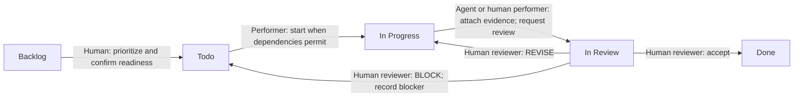

# FixOps delivery workflow

## Work tracking and accountability

FixOps uses the existing **Personal** workspace, **FIX** team, and [**FixOps** project](https://linear.app/fixops/project/fixops-965d39cb6a8a) in Linear. Keep specification, delivery, and acceptance work in that project. Keep each ticket short: a clear title, one sentence about the goal, a checklist and its requirement references. Use Linear fields for the assignee, type, due date, milestone and blockers. Full acceptance criteria and BDD scenarios live in the SRS and traceability matrix; effort estimates stay in the delivery plan.

Use the existing labels `type:specification`, `type:addendum`, `type:test`, `type:feature`, `type:verification`, `type:validation`, `type:documentation`, and `type:gate`. Each issue has one primary type.

**Dmytro Shadura is the human assignee and accountable owner.** An issue may name an agent as its performer in the description or work log; this does not transfer accountability or acceptance authority to that agent. Parallel agents work on independent, explicitly owned artifacts and respect issue dependencies.

## Issue lifecycle

Linear uses the states **Backlog**, **Todo**, **In Progress**, **In Review**, and **Done**. **In Review** belongs to the Started group and means the performer has finished a proposal that awaits human review. **Canceled** and **Duplicate** are reserved for issues removed from scope.



Move the issue out of In Review whenever work resumes, review rejects the proposal, or the human accepts it. A blocked issue stays open with its blocker and dependency recorded. An agent may prepare work and request review. When the human explicitly approves it in the chat or tracker, the agent may enter that approval. The agent cannot invent a human decision.

## Work types and responsibilities

| Type | Performer and deliverable | Human review responsibility |
|---|---|---|
| Specification | Human domain owner with agent support maintains requirements, acceptance criteria, and traceability. | Confirm intended behavior and approve the baseline. |
| Addendum | Agent or human proposes a versioned requirement change with affected IDs and downstream impact. | Approve the change before dependent implementation. |
| Test | Agent or human prepares executable tests or a repeatable acceptance protocol linked to requirements. | Review that checks express the intended behavior and are executable. |
| Feature | Agent or human implements the approved behavior and supplies focused test results. | Review implementation, evidence, and remaining limitations. |
| Verification | A reviewer checks implementation against requirements and approved tests, recording results and defects. | Accept the conformance evidence and resolved findings. |
| Validation | Human representative staff evaluate realistic workshop scenarios with agent support for setup and evidence. | Decide whether the result meets operational needs. |
| Documentation | Agent or human maintains operator, technical, and workflow guidance consistent with approved behavior. | Confirm accuracy and usability. |
| Gate | Agent may assemble evidence and a recommendation; no product code is generated by a gate. | Record GO, REVISE, or BLOCK with rationale. |

The product permission policy is [ADD-001](../spec/addenda/ADD-001-permissions.md): Receptionist and Administrator may cancel at permitted source states, and Administrator inherits all existing staff actions and can correct any RepairOrder field subject to unchanged business rules and audit. Product Administrator permissions do not transfer the human owner's project Gate or Validation authority.

Use a separate verification performer from the feature author where practical. Verification establishes that the implementation matches the specification; validation establishes that the workflow serves its intended users.

## Dependencies and gates

For each package, `T` identifies its Test issue, `F` its Feature issue, and `V` its Verification issue. The mappings below resolve every plan alias to a Linear issue. Dependencies are the native Linear blocking relations, with all predecessor acceptance and gate decisions reserved for the human.

| Package | Test | Feature | Verification |
|---|---|---|---|
| **P1 — Staff access and accounts** | [P1-T / FIX-27](https://linear.app/fixops/issue/FIX-27/test-staff-access) | [P1-F / FIX-28](https://linear.app/fixops/issue/FIX-28/implement-staff-access) | [P1-V / FIX-29](https://linear.app/fixops/issue/FIX-29/verify-staff-access) |
| **P2 — Client, device and order intake** | [P2-T / FIX-30](https://linear.app/fixops/issue/FIX-30/test-client-and-repair-intake) | [P2-F / FIX-31](https://linear.app/fixops/issue/FIX-31/implement-client-and-repair-intake) | [P2-V / FIX-32](https://linear.app/fixops/issue/FIX-32/verify-client-and-repair-intake) |
| **P3 — Diagnosis, estimates and client approval** | [P3-T / FIX-33](https://linear.app/fixops/issue/FIX-33/test-diagnosis-and-approval) | [P3-F / FIX-34](https://linear.app/fixops/issue/FIX-34/implement-diagnosis-and-approval) | [P3-V / FIX-35](https://linear.app/fixops/issue/FIX-35/verify-diagnosis-and-approval) |
| **P4 — Repair evidence and guarded order lifecycle** | [P4-T / FIX-36](https://linear.app/fixops/issue/FIX-36/test-repair-workflow) | [P4-F / FIX-37](https://linear.app/fixops/issue/FIX-37/implement-repair-workflow) | [P4-V / FIX-38](https://linear.app/fixops/issue/FIX-38/verify-repair-workflow) |
| **P5 — Settlement, cancellation, payment and pickup** | [P5-T / FIX-39](https://linear.app/fixops/issue/FIX-39/test-pricing-and-payments) | [P5-F / FIX-40](https://linear.app/fixops/issue/FIX-40/implement-pricing-and-payments) | [P5-V / FIX-41](https://linear.app/fixops/issue/FIX-41/verify-pricing-and-payments) |
| **P6 — Persistent audit and administrator corrections** | [P6-T / FIX-42](https://linear.app/fixops/issue/FIX-42/test-audit-and-order-corrections) | [P6-F / FIX-43](https://linear.app/fixops/issue/FIX-43/implement-audit-and-order-corrections) | [P6-V / FIX-44](https://linear.app/fixops/issue/FIX-44/verify-audit-and-order-corrections) |
| **P7 — Visible-result performance and backup recovery** | [P7-T / FIX-45](https://linear.app/fixops/issue/FIX-45/test-performance-and-recovery) | [P7-F / FIX-46](https://linear.app/fixops/issue/FIX-46/implement-performance-and-recovery) | [P7-V / FIX-47](https://linear.app/fixops/issue/FIX-47/verify-performance-and-recovery) |

| Package | Test blocked by | Feature blocked by | Verification blocked by |
|---|---|---|---|
| P1 | `SPEC`, `PLAN`, `ADD` | `PLAN`, `P1-T` | `P1-F` |
| P2 | `SPEC`, `ACCESS`, `P1-T` | `PLAN`, `P2-T`, `ACCESS` | `P2-F` |
| P3 | `SPEC`, `ACCESS`, `P2-T` | `PLAN`, `P3-T`, `P2-F`, `ACCESS` | `P3-F` |
| P4 | `SPEC`, `ADD`, `ACCESS`, `P3-T` | `PLAN`, `P4-T`, `P3-F`, `ACCESS`, `ADD` | `P4-F` |
| P5 | `SPEC`, `ADD`, `ACCESS`, `P4-T` | `PLAN`, `P5-T`, `P4-F`, `P2-F`, `ACCESS`, `ADD` | `P5-F` |
| P6 | `SPEC`, `ADD`, `ACCESS`, `P1-T` | `PLAN`, `P6-T`, `P2-F`, `P4-F`, `ACCESS`, `ADD` | `P6-F`, `P1-V`, `P2-V`, `P3-V`, `P4-V`, `P5-V` |
| P7 | `SPEC`, `ACCESS`, `P6-T` | `PLAN`, `P7-T`, `P5-F`, `P6-F`, `ACCESS` | `P7-F`, `P6-V` |

Every Feature is blocked by its own Test and PLAN. **P1-T is also blocked by SPEC, ADD, and PLAN**: role/action tests must reflect the human-confirmed cancellation and correction policy. ACCESS blocks P2–P7 Tests and Features; it does not block its own prerequisite P1 work. P6 verification also requires P1–P5 verification, and P7 verification also requires P6 verification.

| Control alias and issue | Purpose | Blocked by |
|---|---|---|
| [SPEC / FIX-23](https://linear.app/fixops/issue/FIX-23/review-requirements) | Review the approved requirements and target-system implementation boundaries. | None |
| [ADD / FIX-24](https://linear.app/fixops/issue/FIX-24/confirm-staff-permissions) | Records the human-approved cancellation and Administrator policy in ADD-001; completed on 2026-10-15. | None |
| [DOC / FIX-25](https://linear.app/fixops/issue/FIX-25/publish-the-delivery-plan) | Publish delivery plan, workflow, traceability, and risk controls for human review. | None |
| [PLAN / FIX-26](https://linear.app/fixops/issue/FIX-26/plan-gate-approve-the-plan) | Human PLAN-GATE decision on traceable scope, dependencies, estimates, and risk controls. | `SPEC`, `ADD`, `DOC` |
| [ACCESS / FIX-48](https://linear.app/fixops/issue/FIX-48/access-gate-check-staff-access) | Human ACCESS-GATE decision on verified staff access and account controls. | `P1-V` |
| [SAFETY / FIX-49](https://linear.app/fixops/issue/FIX-49/financial-data-gate-check-pricing-and-recovery) | Human FINANCIAL-DATA-GATE decision on settlement, audit, performance, and recovery evidence. | `P4-V`, `P5-V`, `P6-V`, `P7-V` |
| [VALIDATE / FIX-50](https://linear.app/fixops/issue/FIX-50/try-the-staff-workflow) | Human acceptance of representative staff workflows against product intent. | `ACCESS`, `SAFETY`, `P1-V`, `P2-V`, `P3-V`, `P4-V`, `P5-V`, `P6-V`, `P7-V` |
| [RELEASE / FIX-51](https://linear.app/fixops/issue/FIX-51/release-gate-approve-the-release) | Human RELEASE-GATE decision on release readiness; does not deploy or publish. | `PLAN`, `ACCESS`, `SAFETY`, `VALIDATE`, `P1-V`, `P2-V`, `P3-V`, `P4-V`, `P5-V`, `P6-V`, `P7-V` |

ADD / FIX-24 is complete following the human's explicit permission decisions; its native dependency edges remain as prerequisite history. No dependent work bypasses the other blockers.

Approval to create planning artifacts does **not** approve PLAN-GATE. Dmytro has now explicitly approved the prepared planning package and authorized recording the decision: PLAN / FIX-26 is GO on 2026-10-15. This does not approve future technical Gates or intent Validation. ACCESS requires accepted P1 verification before staff-dependent delivery proceeds. SAFETY requires accepted P4–P7 verification before Validation begins. Validation additionally requires ACCESS and every package Verification; RELEASE requires PLAN, ACCESS, SAFETY, Validation, and every package Verification. A successful automated check cannot substitute for any of these human acceptances.

A gate decision is one of:

- **GO:** the human accepts the evidence and allows the recorded next stage.
- **REVISE:** evidence or work needs correction; identify follow-up issues and keep dependents blocked.
- **BLOCK:** a prerequisite or decision is missing; name the blocker, responsible owner, and condition for reconsideration.

The Gate issue records the decision, the checks behind it and the next step. The human decides; the agent may enter an approval explicitly given in the chat. Later Gates need their own results. Gate issues do not produce code.

### Where to record a decision in Linear

Open the Gate issue and add a short comment. For example:

```text
GO — plan approved by Dmytro.
The requirements, schedule, dependencies and risks are accepted.
Next: prepare the staff-access tests.
```

- **GO:** set the issue to **Done**.
- **REVISE:** say what needs changing and move the issue back to **In Progress**.
- **BLOCK:** say what is missing and move the issue back to **Todo**, with its blockers linked.

Keep the latest decision in the description and preserve earlier decision comments. Linear keeps the change history; no extra recorder or timestamp fields are required.

## Definition of Ready and Done

**Ready for Todo:** the issue has a clear goal, requirement references and a useful checklist. Its SRS/traceability references supply the full acceptance criteria and scenarios; the delivery plan supplies effort estimates, and Linear fields identify the owner, dates and blockers. Work may start only after its own blocking predecessors are accepted; independent work may proceed while downstream implementation remains blocked.

**Ready for Review:** the performer has attached the deliverables, validation commands or protocol, actual results, and known limitations. Relevant traceability links are updated, and no acceptance claim exceeds the evidence. Move the issue to In Review.

**Done:** the responsible human has accepted the issue's deliverables and evidence, required findings are resolved or explicitly dispositioned, and traceability is current. The checklist records the result; do not add separate Ownership, Handoff or duplicate dependency sections to the description. Apply the following evidence rules:

- **Test:** reviewed executable tests or a reviewed repeatable protocol, including expected results and the actual baseline outcome. Tests for missing behavior may be expected red; Done confirms a sound test artifact and never requires reporting a false pass.
- **Feature:** implemented behavior, focused passing checks for that behavior, and evidence that rejected actions preserve affected records. All listed blocking predecessors must already be accepted, including its own Test, PLAN, and ACCESS where applicable.
- **Verification:** recorded requirement-by-requirement results and disposition of defects; failed required checks prevent acceptance.
- **Validation:** recorded representative staff scenarios and explicit human acceptance; FINANCIAL-DATA must have GO first.
- **Gate:** a recorded human GO and linked evidence. REVISE and BLOCK remain open.
- **Specification, Addendum, Documentation:** reviewed content, consistent references, and the required human approval.

Any change to the approved requirements follows an Addendum issue naming the affected requirement IDs, acceptance criteria, BDD scenarios, and traceability rows before related implementation is accepted. Keep evidence in versioned artifacts or linked issue records; do not infer completion from an issue title or an unexecuted scenario.
