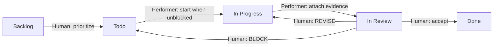
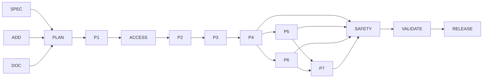

# Delivery workflow

## Tickets

All work is tracked in the [FixOps project](https://linear.app/fixops/project/fixops-965d39cb6a8a) in Linear. A ticket has a title, a one-sentence goal, a checklist, and requirement references. Assignee, type, dates, milestone, and blockers use Linear fields. Acceptance criteria and scenarios live in the SRS; estimates live in the [delivery plan](delivery_plan.md).

Each ticket has one type label: `type:specification`, `type:addendum`, `type:test`, `type:feature`, `type:verification`, `type:validation`, `type:documentation`, or `type:gate`.

A human owns every ticket. Technical acceptance and gate decisions are delegated during implementation: record GO when the requirements, tests, review and verification evidence support it; otherwise record REVISE or BLOCK. Human review follows the implementation batch. A walkthrough performed by staff must still be recorded separately from technical verification.

## Lifecycle



**Canceled** and **Duplicate** are for tickets removed from scope.

## Work types

| Type | Deliverable | Human review |
|---|---|---|
| Specification | Requirements, acceptance criteria, traceability | Approve the baseline |
| Addendum | Requirement change with affected IDs and impact | Approve before dependent work |
| Test | Executable tests or a repeatable protocol | Checks express the intended behavior |
| Feature | Implementation plus focused test results | Implementation, evidence, limitations |
| Verification | Requirement-by-requirement results and defects | Accept conformance evidence |
| Validation | Realistic workshop scenarios tried by staff | Does it meet operational needs? |
| Documentation | Operator, technical, and workflow guides | Accuracy and usability |
| Gate | Evidence and a recommendation; no code | GO, REVISE, or BLOCK |

Where possible, the Verification performer should be different from the Feature author. Verification checks the implementation against the spec. Validation checks that the workflow serves its users.

## Dependencies

`T`, `F`, `V` = Test, Feature, Verification of a package (tickets in the [delivery plan](delivery_plan.md#work-packages)). SPEC = FIX-23, ADD = FIX-24, PLAN = FIX-26, ACCESS = FIX-48, SAFETY = FIX-49, VALIDATE = FIX-50, RELEASE = FIX-51.

| Package | Test blocked by | Feature blocked by | Verification blocked by |
|---|---|---|---|
| P1 | SPEC, ADD, PLAN | PLAN, P1-T | P1-F |
| P2 | SPEC, ACCESS, P1-T | PLAN, ACCESS, P2-T | P2-F |
| P3 | SPEC, ACCESS, P2-T | PLAN, ACCESS, P3-T, P2-F | P3-F |
| P4 | SPEC, ADD, ACCESS, P3-T | PLAN, ADD, ACCESS, P4-T, P3-F | P4-F |
| P5 | SPEC, ADD, ACCESS, P4-T | PLAN, ADD, ACCESS, P5-T, P2-F, P4-F | P5-F |
| P6 | SPEC, ADD, ACCESS, P1-T | PLAN, ADD, ACCESS, P6-T, P2-F, P4-F | P6-F, P1-V … P5-V |
| P7 | SPEC, ACCESS, P6-T | PLAN, ACCESS, P7-T, P5-F, P6-F | P7-F, P6-V |

| Control | Blocked by |
|---|---|
| PLAN | SPEC, ADD, DOC (FIX-25) |
| ACCESS | P1-V |
| SAFETY | P4-V, P5-V, P6-V, P7-V |
| VALIDATE | ACCESS, SAFETY, all V |
| RELEASE | PLAN, ACCESS, SAFETY, VALIDATE, all V |



## Gate decisions

- **GO:** evidence accepted; dependent work may start. Set the gate ticket to **Done**.
- **REVISE:** name what must change; move to **In Progress**; dependents stay blocked.
- **BLOCK:** name the missing prerequisite; move to **Todo** with blockers linked.

Record the decision as a comment on the gate ticket:

```text
GO — plan approved.
Requirements, schedule, dependencies and risks accepted.
Next: prepare the staff-access tests.
```

Passing automated checks alone does not justify GO: review conformance, actual outcomes and remaining limitations as well. Delegated technical approval does not claim that a human walkthrough has occurred.

## Definition of Ready and Done

**Ready:** a clear goal, requirement references, and a checklist. Work starts only when its blockers are Done.

**In Review:** deliverables, commands or protocol, actual results, and known limitations are attached. Traceability is updated.

**Done:** the human accepted the evidence, and findings are resolved or dispositioned. By type:

- **Test:** a reviewed test or protocol with expected results and the actual baseline outcome. Tests for missing behavior may fail at this stage.
- **Feature:** the behavior works, focused checks pass, and rejected actions leave records unchanged.
- **Verification:** results for each requirement; any failed required check blocks acceptance.
- **Validation:** staff scenarios recorded and accepted. Requires FINANCIAL-DATA GO.
- **Gate:** human GO with linked evidence.
- **Specification, Addendum, Documentation:** content reviewed, references consistent, human approved.

A change to approved requirements needs an Addendum ticket naming the affected requirement IDs, acceptance criteria, scenarios, and traceability rows. Related implementation is accepted only after that addendum.
